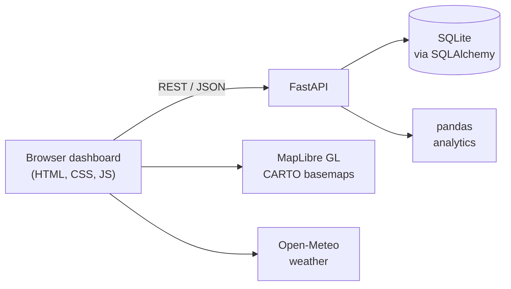

<div align="center">

# Freight Tracker

### One shipment. Four ways to see it. Built for the Southern Africa freight corridor.

A full-stack shipment tracking dashboard for logistics teams, with a live map, document workflow, route legs and historical delay analytics.


</div>

---

## The Idea

A consignment leaves Gaborone by road, crosses the border at Mamuno, reaches Walvis Bay, sails past the Canary Islands and finally berths in Rotterdam. Along the way it can be delayed by a border queue, a missing invoice, a port backlog or a storm.

Different people need different answers from the same shipment:

| Team | Their question | Default view |
|---|---|---|
| Operations | Where is everything, and what is about to go wrong? | Live map |
| Documentation and customs | Which paperwork is missing? | Focused page |
| Customer service | How do I explain the delay to a client? | Story |
| Finance and planning | Where did we lose time? | Data |

Freight Tracker keeps **one shipment record** and shows it through four views, with each role opening on the view that suits its job.

---

## Screenshots

<!-- Add your own images to the docs folder, then keep these lines. -->

| Live map (light) | Live map (dark) |
|---|---|
|  |  |

| Focused view | Shipment story |
|---|---|
|  |  |

---

## Features

**Map and tracking**
- Interactive MapLibre GL map with the road leg, sea route, completed track and vessel heading
- Layer toggles for vessels, ports, weather and port congestion
- Wind and gust readings at the vessel position from Open-Meteo
- Light and dark basemaps that follow the app theme

**Shipment record**
- Multimodal legs: road, border crossing, port dwell and sea, each with planned vs actual dates and variance in hours
- Document checklist with upload and verify, saved to the database
- Activity log that updates when something changes

**Roles and views**
- Four views: live map, focused with tabs, shipment story with map snapshots, and data-first
- Role-based default view, with free switching between views
- Light, dark and auto themes; responsive from phone to control-room screen

**Analytics**
- Historical summary endpoint: on-time rate, average delay, delay by route and by month, computed with pandas over 90 sample deliveries

---

## Architecture



The database is reached only through SQLAlchemy, so moving from SQLite to PostgreSQL means changing one environment variable, `DATABASE_URL`.

---

## Quick Start

You need Python 3.10 or newer.

```bash
git clone https://github.com/Deirdre24/freight-tracker.git
cd freight-tracker

python -m venv .venv
.venv\Scripts\Activate.ps1        # Windows PowerShell
# source .venv/bin/activate       # macOS / Linux

pip install -r requirements.txt
uvicorn app.main:app --reload
```

Then open:

- **http://localhost:8000** for the dashboard
- **http://localhost:8000/docs** for the interactive API documentation

The first start creates `tracker.db` and fills it with sample data. Delete the file any time to reset it.

Run the tests with:

```bash
pytest
```

---

## API

| Method | Endpoint | Returns |
|---|---|---|
| GET | `/api/health` | Service status |
| GET | `/api/shipments?status=active` | Shipment list, optionally filtered |
| GET | `/api/shipments/{id}` | Shipment with legs, documents and activity log |
| GET | `/api/shipments/{id}/track` | Route segments, vessel position and heading, ports and congestion |
| POST | `/api/shipments/{id}/documents/{doc_id}/verify` | Marks a document verified and logs the event |
| GET | `/api/analytics/summary` | On-time rate, average delay, results by route and by month |

---

## Project Structure

```
freight-tracker/
|-- app/
|   |-- main.py          # FastAPI routes and analytics
|   `-- db.py            # Models, database setup, sample data
|-- static/
|   `-- index.html       # Dashboard: views, themes, map
|-- tests/
|   `-- test_api.py      # API tests
|-- docs/                # Screenshots
|-- REQUIREMENTS.md      # Product requirements and wishlist
`-- requirements.txt
```

---

## Roadmap

- [x] Shipment record with legs, documents and activity log
- [x] Four role-based views and light/dark themes
- [x] Real map with route, vessel, ports, congestion and weather
- [x] Historical analytics endpoint
- [ ] History screen with filters and CSV export
- [ ] Select any shipment from the list
- [ ] Real login, company accounts and permissions
- [ ] Live vessel positions from an AIS provider
- [ ] PostgreSQL and cloud deployment

The full wishlist is in [REQUIREMENTS.md](REQUIREMENTS.md).

---

## Honest Notes

- This is a prototype. All shipments, documents and the 90 historical deliveries are **sample data**.
- The vessel position is **simulated** along an approximate route, not read from live tracking.
- Basemaps are from CARTO and weather is from Open-Meteo. Both are fine for development, but a commercial product would need their commercial terms checked.

---

## Author

**Deirdre Gouta Mmolotsa**, Business Intelligence and Data Analytics graduate, Botswana.

[LinkedIn](https://www.linkedin.com/in/deirdre-gouta-mmolotsa-517838306/) | [dmmolotsa@gmail.com](mailto:dmmolotsa@gmail.com)

## Licence

MIT. See [LICENSE](LICENSE).
